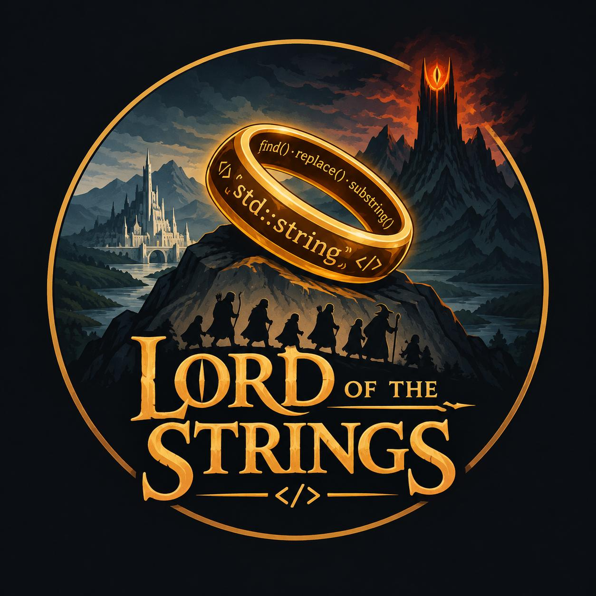

  

<h1 align="center">Lord of the Strings</h1>

  Gruppo 18 · Lord of Strings · Ingegneria del Software 2026-2027 
  Università degli Studi di Padova

Questo spazio raccoglie il lavoro svolto dal gruppo **Lord of Strings** nell'ambito del corso
di Ingegneria del Software per l'anno accademico 2026-2027.

## Repository

- [Documentazione](https://github.com/LordOfTheStrings-SWE/Documentazione): contiene tutta la documentazione prodotta durante il progetto

## Membri del gruppo

| Cognome      | Nome             | Matricola |
| :----------- | :--------------  | :-------- |
| Biba         | Giovanni         | 2113176   |
| De Lucchi    | Giacomo          | 2086020   |
| Gyulai       | Costanza         | 2076445   |
| Moro         | Michele          | 2148011   |
| Sironi       | Stefano          | 2111037   |
| Tuoni        | Angelo           | 2116405   |
| Yi Ming      | Ye               | 2137995   |

## Contatti

Email: [lordofthestrings03@gmail.com](mailto:lordofthestrings03@gmail.com)